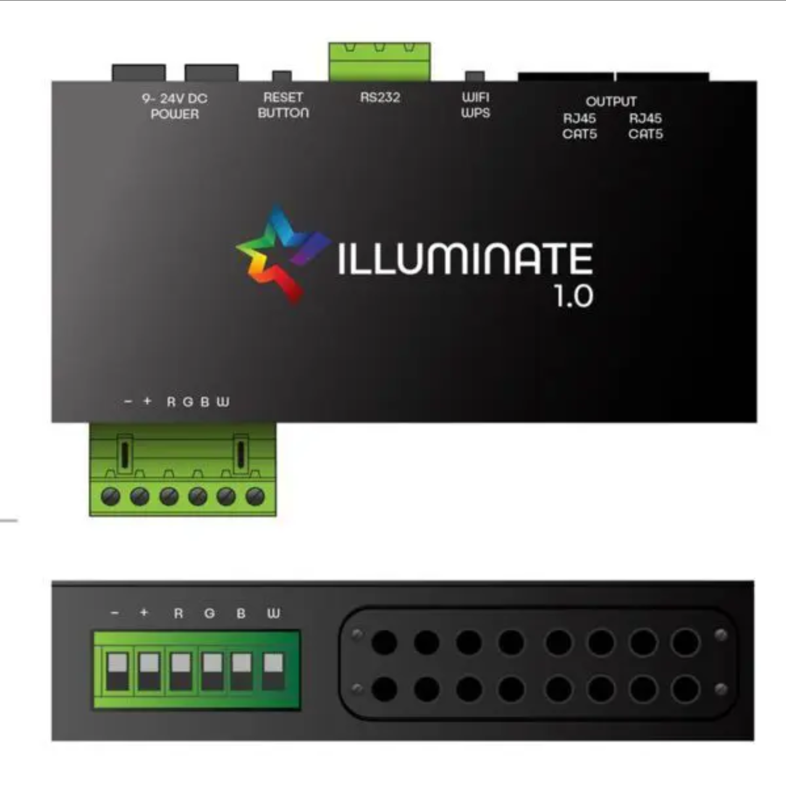
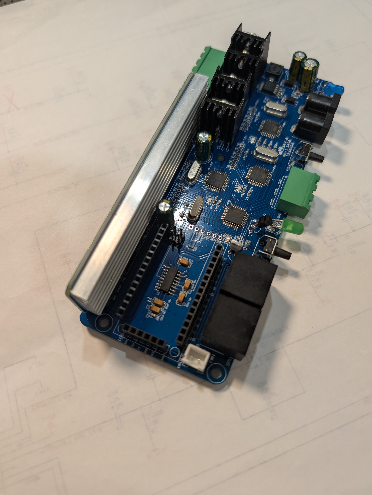

# esphome-illuminate

An ESPHome external component for the Fusion Synergy "Illuminate 1.0" star ceiling /
ambient lighting controller, so it can be driven natively from Home Assistant over a
direct UART connection instead of the proprietary Bluetooth phone app.



> **Built with [Claude Code](https://claude.com/claude-code).** The RS232 protocol was
> reverse-engineered and validated against real hardware by the repo owner; the ESPHome
> component (Python codegen, C++ classes, and this README) was written by Claude Code
> against that protocol and the manual linked below, then verified by actually compiling
> it with `esphome compile`. Review the code with that in mind.

**Status:** the protocol layer, hub component, both light platforms (Ambient Light and
Starry Night), the Starry Night color-transition select, and the Shooting Star light are
all implemented and pass `esphome compile` against the example config. Starry Night
effects/colors and both dimmers have been bench-validated against real hardware over a
wired UART connection; Ambient Light effects/colors are implemented per the manual but
not yet bench-tested (see "What's actually been tested" below). Shooting Star is
implemented per the manual but is **not functional on SP-firmware units** — see below.

## What this hardware is

The Illuminate 1.0 is a 4x-ATmega328 controller board for fiber-optic/LED "star ceiling"
and ambient lighting installations, normally controlled from a phone app over Bluetooth
(an HM-10 BLE UART-passthrough module) or a wired RS232 connector (via an onboard
MAX3232 level shifter). This component bypasses both: it talks directly to the TTL-level
UART pins the HM-10 module normally occupies, from an ESP8266 dev board plugged into the
same socket.

Official manual: [`docs/IlluminateUserManual.pdf`](docs/IlluminateUserManual.pdf).

## SP vs. SS firmware — read this before wiring up Shooting Star

The board's "Main" MCU ships with one of two mutually exclusive firmware loads,
confirmed directly with Fusion Synergy's designer:

- **SP firmware** — static star panels. Supports Starry Night and Ambient Light.
- **SS firmware** — motorized/addressable "shooting star" zones. Supports Shooting Star.

**A single unit only supports one or the other.** Shooting Star commands are silently
accepted and ignored on SP-firmware units — the hardware won't error, log, or otherwise
indicate anything is wrong, it simply won't move. If your `shooting_star` light entity in
Home Assistant appears to do nothing, this firmware mismatch is almost certainly why.
Omit the `type: shooting_star` light from your config entirely if you only have an
SP-firmware board; there's nothing else to disable.

## Wiring



The board above has its wireless module (HM-10 BLE or an ESP8266, depending on SKU)
removed, showing the header socket this component connects to instead. Connect the
ESP8266 directly to that header (labeled `D0`-`D8` or similar depending on board
silkscreen revision):

| ESP8266 | Illuminate board |
|---------|-------------------|
| GND     | GND               |
| TX      | RX (board's UART RX, feeds the Main MCU) |
| RX      | TX (board's UART TX)                     |

9600 baud, 8N1, no flow control, no parity. This UART bus should be dedicated to the
`illuminate:` hub — don't attach any other `uart` device to the same bus/pins.

**5V logic level warning:** the board runs its UART at 5V TTL levels. The board's TX
line, wired directly into your ESP8266's RX pin, will drive 5V into a pin many ESP8266
dev boards only tolerate up to 3.3V. **Verify your specific dev board's RX pin is 5V
tolerant before wiring this directly** (some ESP-12E NodeMCU clones are, many aren't —
check your board's datasheet), or add a level shifter / simple resistor voltage divider
on that line. ESP8266 TX → board RX is fine without shifting either way, since the
board's RX threshold accepts 3.3V logic as a valid high.

## Daisy-chaining an SP board and an SS board

To get both Starry Night/Ambient (SP firmware) and Shooting Star (SS firmware) control
from one ESP8266, run **two `uart:` buses and two `illuminate:` hubs** in one YAML — the
ESP8266 has enough spare GPIOs for a second software/hardware UART pair:

```yaml
uart:
  - id: uart_sp
    tx_pin: GPIO1
    rx_pin: GPIO3
    baud_rate: 9600
  - id: uart_ss
    tx_pin: GPIO14
    rx_pin: GPIO12
    baud_rate: 9600

illuminate:
  - id: hub_sp
    uart_id: uart_sp
  - id: hub_ss
    uart_id: uart_ss

light:
  - platform: illuminate
    type: starry_night
    illuminate_id: hub_sp
    ...
  - platform: illuminate
    type: shooting_star
    illuminate_id: hub_ss
    zone: zone_1
    ...
```

The `illuminate:` hub supports multiple instances (`MULTI_CONF`) specifically for this.
This has not yet been bench-tested against two physical boards on one ESP8266 (the
repo owner is still acquiring the second, SS-firmware board) — treat it as
implemented-per-design rather than field-validated until confirmed.

## Design notes / tradeoffs

- **Turning a light "off":** the manual has no documented power on/off command for
  Starry Night or Ambient Light (only effects, color, and a 10-100% dimmer). "Off" is
  approximated by sending the RGBW color command with all channels zeroed. This leaves
  the dimmer and any active effect at their last commanded value on the hardware — if
  that turns out to be wrong on real hardware, it would fail the same way the Shooting
  Star investigation did (looks correct, silently doesn't do what you'd expect).
- **Starry Night color transitions** (Wipe/Fade/Rainbow/Blink) are modeled as a companion
  `select:` entity (`illuminate_color_transition`) rather than folded into the Starry
  Night light's `effects:` list. The manual describes them separately from the six
  animation effects, and they're a modifier layered on top of whatever color/effect is
  currently active, not an alternate mode — folding all ten into one ESPHome effect list
  would force choosing only one of e.g. "Twinkle" or "Wipe" at a time in HA, when the
  hardware lets both be active together.
- **Ambient effect speed** (150-255, for Fade/Blink) is a fixed config-time parameter on
  each effect entry in YAML (like core ESPHome effects such as `pulse` carry a fixed
  `transition_length`), not a live HA control — HA's effect picker only lets you choose
  *which* effect is active, not tune a running effect's parameters, so a runtime speed
  slider wouldn't be reachable from the HA UI regardless.
- **Shooting Star** is modeled as a `light` rather than a `button` + `number`/`select`.
  A shot is fundamentally "a color, fired for a duration," which maps naturally onto a
  light's color + on/off, and gets HA's color picker for free. The tradeoff: shot
  *duration* doesn't fit HA's light data model at all (it's not brightness or a
  transition), so it's a fixed config-time value (`duration:`) per light entry rather
  than adjustable per-shot from the HA UI — add one `illuminate` light entry per
  zone/duration combination you want available if you need more than one duration at
  runtime. Turning the light off sends the manual's explicit
  `{Zone},0,0,0,0,0*` shorthand, canceling an in-flight shot immediately.
- **Brightness floor:** the hardware's dimmers only go down to 10%, not 0. ESPHome's
  0.0-1.0 brightness range is mapped linearly onto 10-100% (`pct = round(10 + b*90)`)
  rather than snapping straight to the floor, so the full HA brightness slider range
  remains meaningful.

## What's actually been tested

Confirmed against real hardware over a wired UART connection: Starry Night effects,
Starry Night colors, and the star dimmer. Implied by protocol symmetry but **not yet
bench-tested**: Ambient Light effects/colors, the ambient dimmer, and the four color
transitions. Shooting Star is implemented exactly per the manual's command tables but is
confirmed **not functional** on this repo owner's SP-firmware unit (expected — see "SP
vs. SS firmware" above) and has not been tested against SS-firmware hardware yet.

## Repo layout

```
components/illuminate/
├── __init__.py                 # illuminate: hub config + shared protocol enums
├── illuminate.h / .cpp         # IlluminateHub: Component + UARTDevice
├── illuminate_protocol.h / .cpp  # pure command-string builders, no ESPHome deps
├── light/
│   ├── __init__.py             # platform: illuminate under light: (type: starry_night
│   │                           # / ambient / shooting_star, see note below)
│   ├── starry_night_light.h / .cpp
│   ├── ambient_light.h / .cpp
│   └── shooting_star_light.h / .cpp
└── select/
    ├── __init__.py             # platform: illuminate under select: (color transition)
    └── illuminate_color_transition_select.h / .cpp
```

Note: ESPHome resolves a platform as `esphome.components.<platform>.<domain>`, so a
single `platform: illuminate` light entry can only live at `components/illuminate/light/`
— there's no way to give Shooting Star its own `platform:` name without giving it its own
top-level component directory outside `illuminate/`. Rather than do that, Shooting Star
is a third `type:` option on the same `platform: illuminate` light entry as Starry Night
and Ambient (see `light/__init__.py`), distinguished by a required `type:` config key.

## Development

The pure protocol layer has no ESPHome or Arduino dependencies and can be built/tested
with a desktop compiler:

```sh
cd tests
g++ -std=c++17 -Wall -Wextra -I ../components/illuminate \
    test_illuminate_protocol.cpp ../components/illuminate/illuminate_protocol.cpp \
    -o test_illuminate_protocol
./test_illuminate_protocol
```

`tests/test_config.yaml` is a config exercising every platform/type combination, useful
for `esphome config` / `esphome compile` sanity checks against this repo's
`external_components:` local source while developing.

See `examples/example.yaml` for a config meant to be copied into a real device's YAML.

## License

MIT — see [LICENSE](LICENSE).
